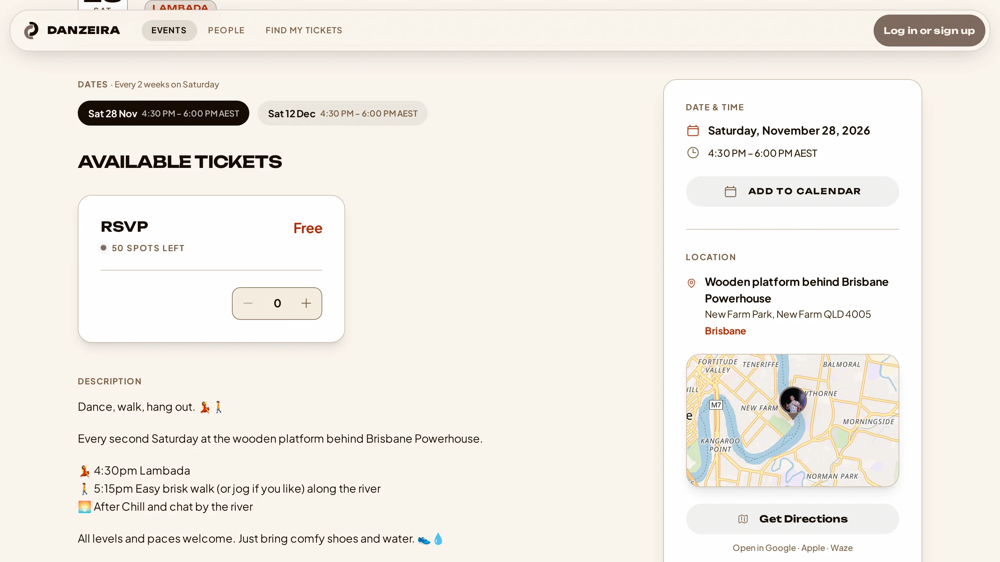
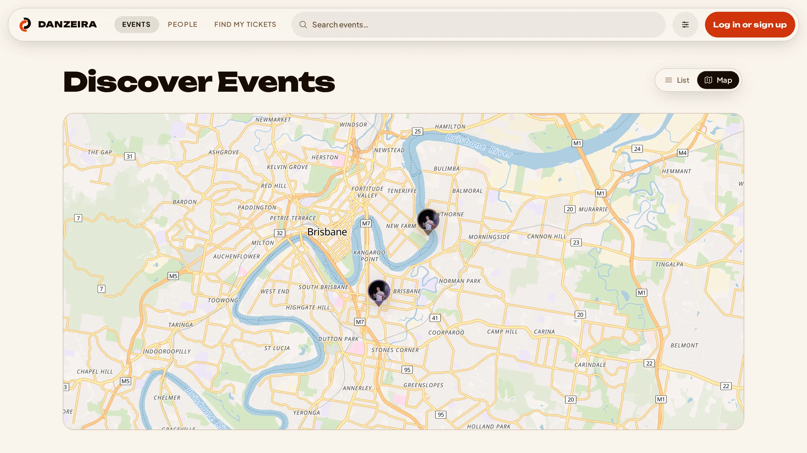
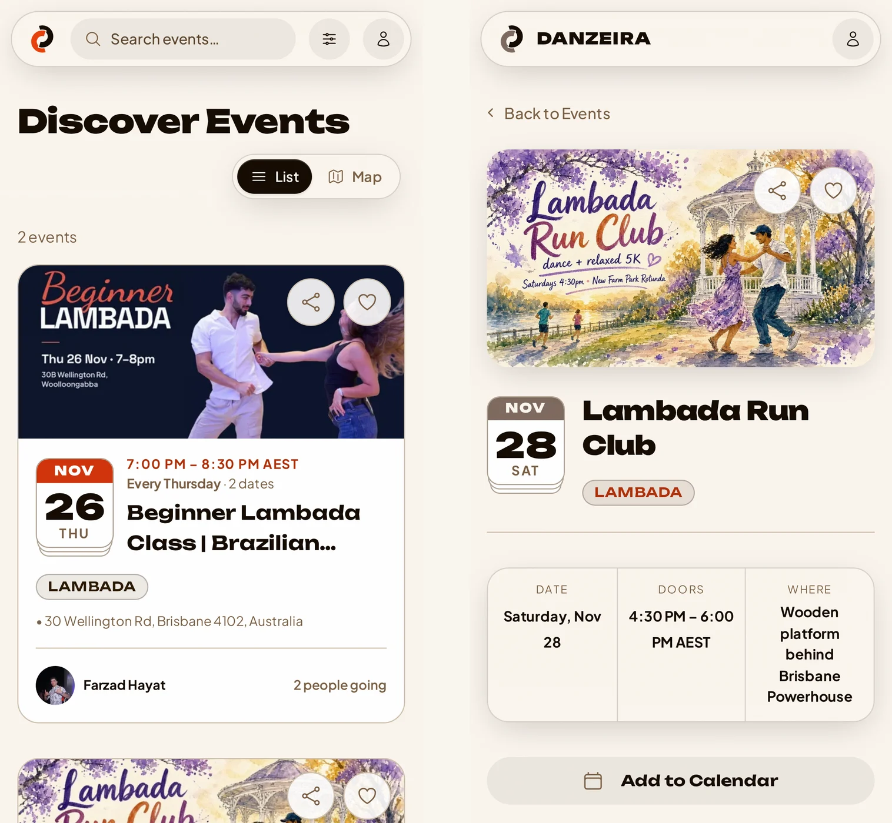

Danzeira is a live ticketing and community platform for partner dance events (Brazilian Zouk, Lambada, Salsa and more). Organisers sell tickets for free and keep 100% of their revenue. Dancers pay one 5% booking fee at checkout, with no extra surcharges.

Generic ticketing platforms treat a Zouk social like a conference. They take a big cut, hide fees at checkout, and ignore how partner dance events work. The leader/follower ratio matters, community trust matters, and events are scattered across Facebook groups, Instagram posts and lots of websites. After hundreds of events as a dancer, I wanted something better. So I built it.

It has features made for partner dance. Ticket tiers have caps for leaders and followers, to keep the ratio balanced on the floor. Organisers scan QR codes at the door from their phone. Attendees get push notifications and a one-tap calendar export. Every organiser is reviewed before they can publish. Each organiser connects their own Stripe account, so payments go directly to them. A native Android shell built with Hotwire Native covers mobile.

There is one place to find what's on near you, instead of hunting through Facebook and Instagram.

Organisers can also run their events from an AI assistant. Danzeira has a public REST API, a CLI and a remote MCP server at `danzeira.com/mcp`. The MCP server has 50 tools for events, tickets, check-ins, promo codes and more. Sign-in uses OAuth 2.1, so there are no API keys to copy, and each organiser can only reach their own events. The [Danzeira plugin for Cursor](https://github.com/FarzadHayat/danzeira-mcp) adds a skill that walks the agent through a full event setup. It also adds a rule: the agent must ask before it publishes, refunds or cancels anything.

I build Danzeira with AI coding agents: Claude Code, Cursor, Grok Bot and T3 Code. I plan each change, agents write the code, and I review and test it before it ships. CI, nightly Playwright tests and Sentry catch what review misses. Working this way, I merged 200+ pull requests on my own since February 2026.

It runs on Ruby on Rails with PostgreSQL, Hotwire and Tailwind CSS. Stripe Connect handles payments, AWS S3 stores files, Solid Queue runs background jobs, Resend sends email and Sentry tracks errors. It deploys to Heroku. Tests use Minitest and Playwright.
