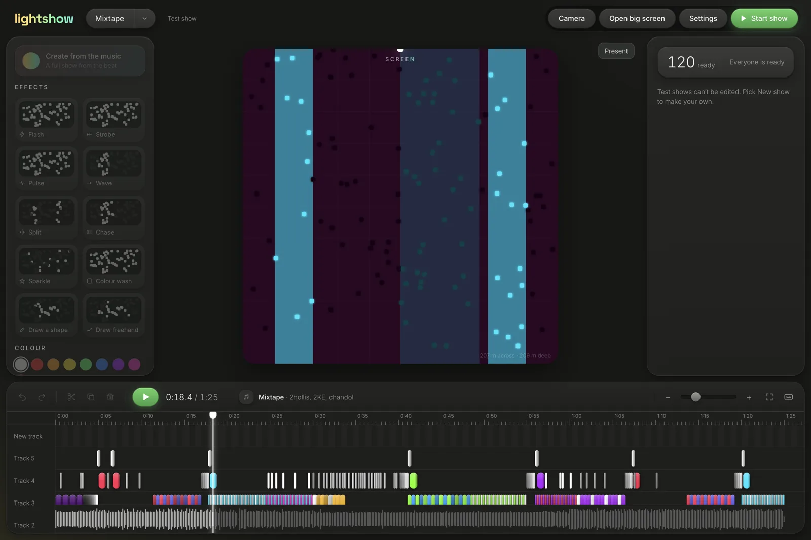
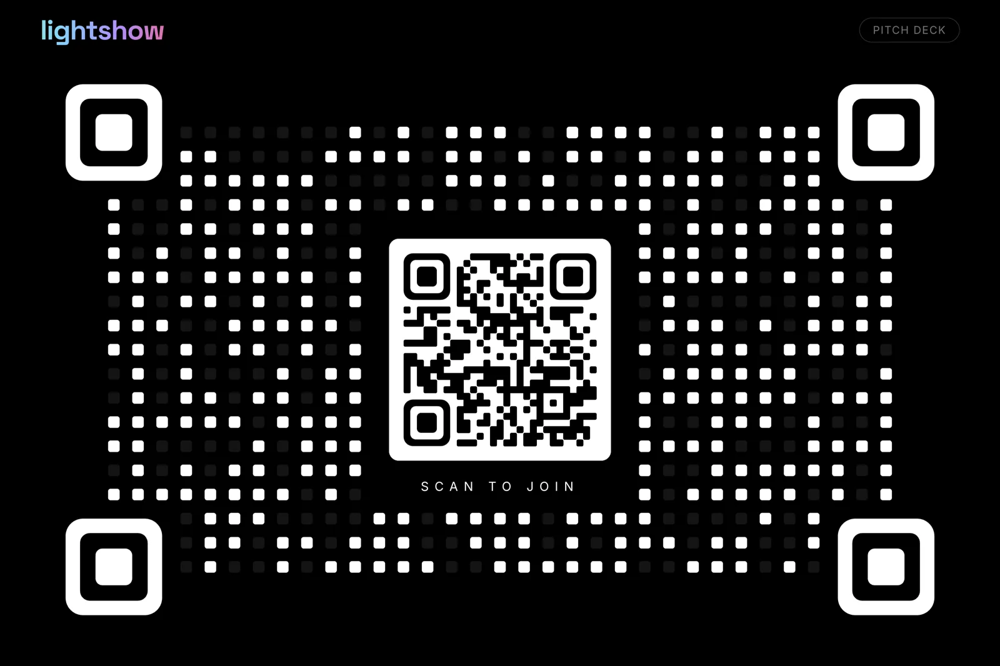

import { Image } from "astro:assets";
import phoneScan from "../../assets/projects/lightshow/phone-scan.webp";
import phoneFound from "../../assets/projects/lightshow/phone-found.webp";

[lightshow](https://lightshow.party) turns a crowd's phones into one big light show. We built it in a team of five at the **Tanda Hackathon 2026** in Brisbane.

  <video
    src="/videos/lightshow-demo.mp4"
    poster="/videos/lightshow-demo-poster.webp"
    controls
    playsinline
    preload="metadata"
    aria-label="26 second demo of lightshow: the live crowd at the Tanda Hackathon holding up lit phones, a phone finding its seat from the big screen, the show editor, the 3D preview and the whole room lighting up in sync"
    class="w-full h-full"
  ></video>

A host draws the venue, adds an audio track and paints light effects onto a timeline. They can also generate a full show from the music. At the event, people scan a QR code on the big screen and the show opens in their phone browser. There is nothing to install.

Each phone needs to know where it is in the room. Nobody types a row or seat number. You point your phone camera at the big screen for a second. The four corner anchors and a grid of about 300 dots give the phone enough points to work out its position in metres. You check your spot on the room map and tap Ready.

  <Image src={phoneScan} alt="Phone camera in a dark auditorium, locking onto the corner anchors on the big screen" class="rounded-xl" />
  <Image src={phoneFound} alt="Seat found on the room map, 3.4 m from the screen and 1.2 m left of centre" class="rounded-xl" />

Every phone then syncs its clock with the server over WebSockets and downloads its own light schedule. The schedule is computed in advance from the show and the seat, so all phones play in time without live commands.

Before the event, the host can simulate a crowd joining and watch the whole venue play back in 3D.

My part was the stage lighting and motion for our pitch deck, and a built-in demo show with its own track. Etao built the sync engine, the schedule compiler and the audio-reactive generator. William built camera seat finding and the rooms editor. Chloe designed the host room and the branding. Lliam built the 3D crowd viewer.
