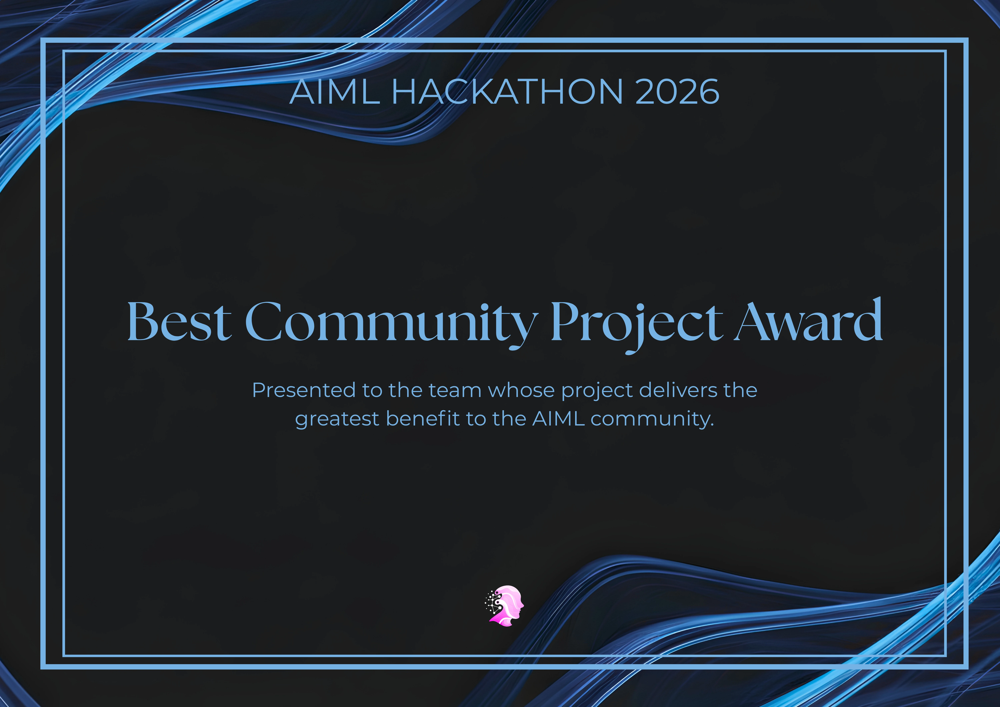
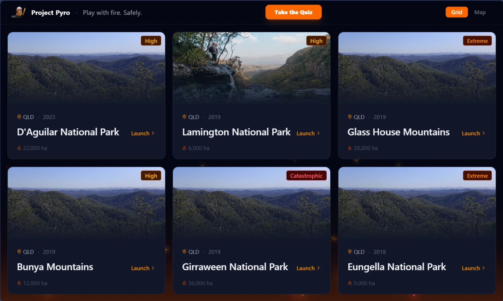
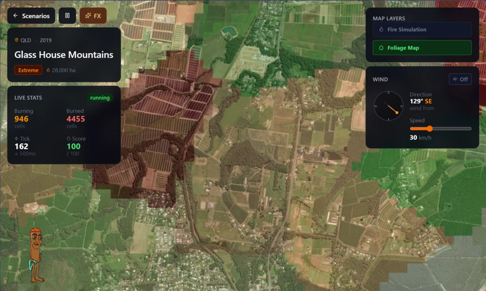
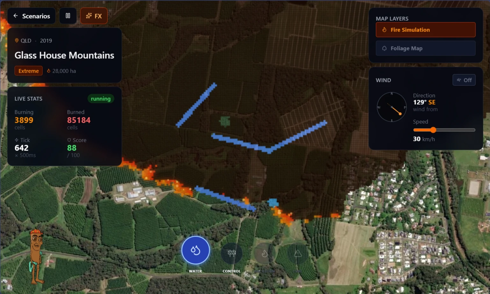
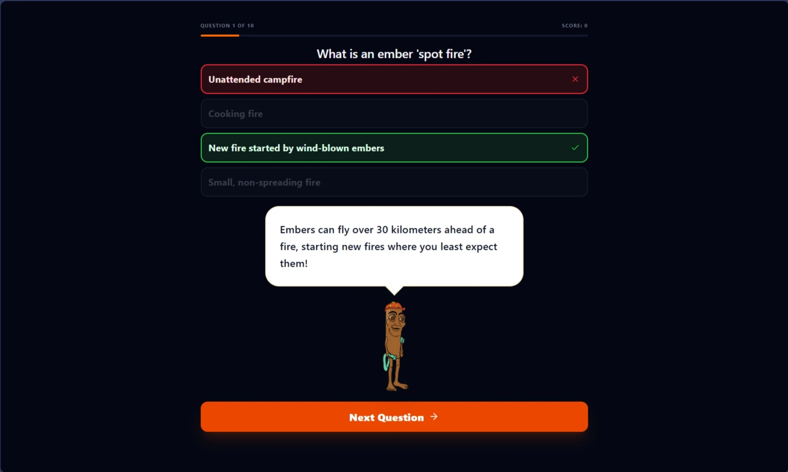

*Play with fire. Safely.*

Project Pyro is a browser-based wildfire simulation game for teens and young adults. You fight real Queensland bushfires on interactive satellite maps and learn how fire behaves as you play. We built it in 48 hours for the **QUT AIML Hackathon 2026**, and it won the **Best Community Project Award**.





Wildfire science is abstract. Fire spread, ember spotting and fuel moisture are hard to picture, and we wanted to make them hands-on.

The simulation runs the **Alexandridis cellular automata model** in the browser, on a 1,000×1,000 grid at 10m resolution. Each scenario covers 10×10 km. Every tick, the chance a cell burns depends on wind, vegetation, slope and fuel moisture:

```
P_burn = P₀ · (1 + P_veg) · (1 + P_den) · P_w · P_s
```

The wind factor `P_w = exp(V · [0.045 + 0.131·(cos(θ)−1)])` makes fire spread 2.5× more toward the downwind side. The six playable scenarios are real bushfires, each on real satellite imagery:

- D'Aguilar National Park (2023, 22,000 ha)
- Glass House Mountains (2019, 28,000 ha)
- Girraween (2019, 36,000 ha)
- Bunya Mountains (2019, 12,000 ha)
- Lamington National Park (2019, 6,000 ha)
- Eungella (2018, 9,000 ha)



You contain each fire before it burns the whole map. A Water Drop wets a 5×5 circle of cells for about 10 seconds, with a 3-second cooldown. A Control Line places a permanent firebreak with two clicks (max 30 cells, 10-second cooldown). A live panel shows burning cells, hectares lost, wind and a score based on area saved against time.



Fire, vegetation and control lines are drawn on custom HTML5 Canvas layers over React-Leaflet, not as DOM elements. DOM elements would freeze the browser with a million cells and 500ms ticks. Grid state lives in a ref instead of React state to avoid re-renders. Embers drift with the wind (capped at 600 particles).

A 10-question randomised quiz covers fire behaviour, Australian ecology and survival tactics. A mascot reacts to what you do, like water drops, wind changes, winning and losing.



The Python backend (FastAPI, Rasterio, GeoPandas) processes real ABS shapefiles and SRTM elevation data. It converts between EPSG:3577 and EPSG:4326 so simulation cells line up with live satellite tiles. During the hackathon the frontend used a client-side MockWebSocket. The backend is wired to take over with one URL change in `useSimulation.js`.

The frontend uses React 18, Vite, React-Leaflet and HTML5 Canvas, with Tailwind CSS v4 for a glassmorphic "Tactical Sentinel" UI in dark navy and orange. The backend also uses NumPy and SciPy. Vegetation comes from procedural Voronoi maps.
